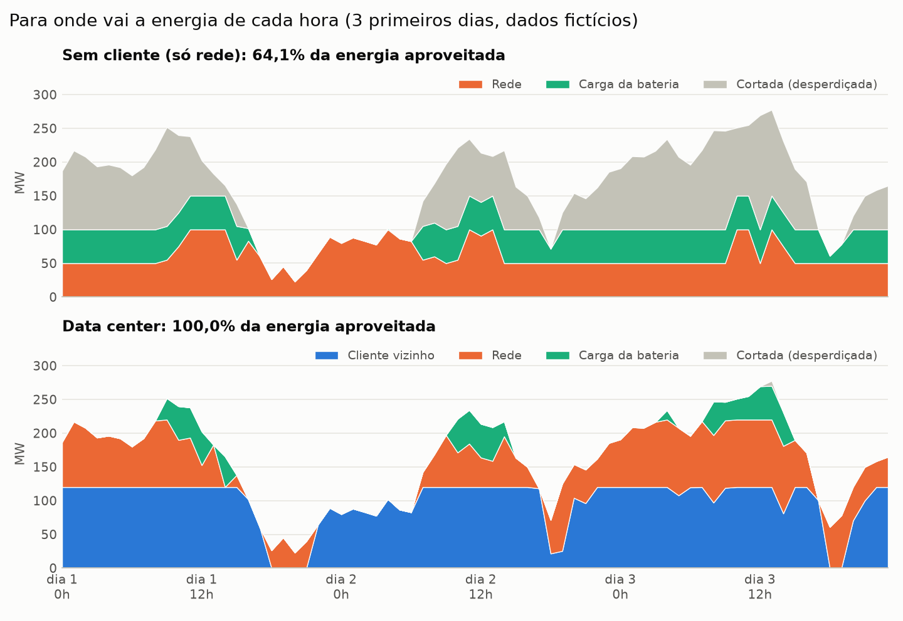
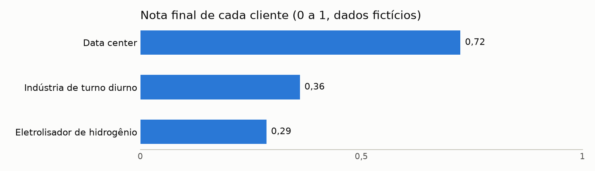

# Campus de energia: simulação hora a hora

> **Todos os dados são fictícios.** Nenhum número vem de um parque, cliente ou empresa real. Dinheiro aparece em "u.m." (unidade monetária fictícia).

## O problema

Um parque eólico e solar gera mais do que cabe na sua linha de conexão com a rede: vale a pena trazer um grande consumidor para o lado do parque, e qual tipo de consumidor?

## O que eu fiz

1. **Simulação hora a hora (programação linear).** Para cada hora de uma semana, o modelo decide quanto da geração vai para o cliente vizinho, para a rede e para a bateria, de modo que a receita seja a maior possível.
2. **Preço-sombra.** O modelo responde: "quanto a receita subiria com 1 MW a mais de conexão?"
3. **Matriz de decisão com pesos.** Três tipos de cliente recebem uma nota final a partir de quatro critérios: receita, energia aproveitada, prazo e empregos locais.

## O resultado

**Com um data center ao lado, o parque fictício aproveita 100% da energia em vez de 64%, e a receita da semana quase dobra (+96%).**



| Cenário | Receita (u.m.) | Energia aproveitada | 1 MW a mais de conexão vale (u.m./semana) |
|---|---:|---:|---:|
| Sem cliente (só rede) | 1.678.892 | 64,1% | 15.450 |
| Data center | 3.284.602 | 100,0% | 1.350 |
| Indústria de turno diurno | 2.781.119 | 93,2% | 7.800 |
| Eletrolisador de hidrogênio | 2.767.045 | 100,0% | 1.977 |

Como ler a última coluna: sem cliente, a conexão é o gargalo e cada MW a mais vale muito. Com o data center, quase toda a energia já tem destino, então ampliar a conexão vale 11 vezes menos.



O data center ganha com os pesos do exemplo (receita 40%, energia aproveitada 25%, empregos locais 20%, prazo 15%). Se o peso maior for para **prazo** ou **empregos locais**, quem ganha é a indústria de turno diurno. A decisão depende dos pesos, e o modelo mostra isso. Tabelas completas em [resultados.md](resultados.md).

## Como rodar

Precisa de Python 3.11 ou mais novo.

```bash
git clone https://github.com/gabriela-doria/campus-de-energia
cd campus-de-energia
python -m venv .venv
.venv\Scripts\activate
pip install -r requirements.txt
python testes.py
python rodar.py
```

No Mac ou Linux, troque a quarta linha por `source .venv/bin/activate`.

| Arquivo | O que tem |
|---|---|
| `dados.py` | Os dados fictícios e os pesos. É aqui que se muda o cenário. |
| `modelo.py` | A programação linear, o preço-sombra e a matriz de decisão. |
| `testes.py` | Seis conferências do resultado. |
| `rodar.py` | Roda tudo e gera `resultados.md` e os gráficos. |

### Como eu conferi

- **Conta na mão.** Sem bateria, cada hora se resolve sozinha (a energia vai primeiro para quem paga mais). A programação linear dá a mesma receita.
- **Preço-sombra.** Rodei de novo com 1 MW a mais e 1 MW a menos de conexão. A diferença de receita bate com o valor que o modelo informa.
- **Balanço.** Em todas as horas, a energia gerada é igual à soma dos destinos, e nenhum limite é ultrapassado.

## Limites e premissas

- **Dados fictícios.** Geração, preços, consumo, prazos e empregos são valores de exemplo, criados por fórmulas simples com semente fixa.
- **Uma semana só.** Não há variação entre estações do ano nem entre anos.
- **Previsão perfeita.** O modelo conhece a semana inteira de antemão. Na vida real há erro de previsão.
- **O cliente não é atendido 100% pelo parque.** Quando falta geração, ou quando a rede paga mais (das 18h às 22h no exemplo), o cliente compra de outra fonte. Esse custo não entra na conta.
- **Sem custo de investimento.** A conta é de receita. Não inclui o custo da bateria, da linha ou das obras.
- **"Energia aproveitada"** é tudo o que não foi cortado. A perda de 10% na carga da bateria conta como aproveitada.
- **Notas de 0 a 1** comparam só estas três alternativas. Uma quarta alternativa mudaria as notas.

## Como construí

Exercício pessoal, feito em novembro de 2026, com os métodos que estudei em Análise de Sistemas Ambientais (Poli-USP): programação linear, preço-sombra e decisão multicritério. Eu defini o problema, os métodos e os critérios. O código foi escrito com IA (Claude como agente de código) e conferido com os testes acima. Não usa material da disciplina.

---

Feito por [Gabriela Dória](https://github.com/gabriela-doria) · Licença [MIT](LICENSE)
